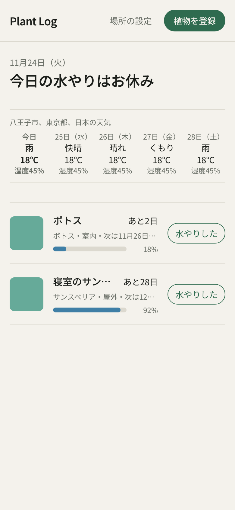

# Plant Log（観葉植物の水やり記録）

観葉植物を登録して、育て方と水やりを管理するアプリです。
その地域の**気温・湿度・雨**をもとに、「次の水やりはいつごろか」を植物ごとに計算します。



## できること

- 植物の登録（よくある観葉植物 15 種類から選ぶか、名前を入れて Wikipedia で探す）
- 植物ごとの育て方（日当たり・最低温度・水やり間隔・湿度）と、Wikipedia の説明・写真
- 天気（Open-Meteo）を使った「次の水やり」の目安と、土の水分ゲージ
- 水やりの記録（ボタン 1 つで今日の分、過去の日付も追加・取り消しできる）
- 記録はブラウザ（localStorage）に保存。あとで Cloudflare D1 に移す予定

## 使っている道具

TypeScript / Next.js 16 / React / Tailwind CSS v4 / Cloudflare Workers（@opennextjs/cloudflare）
→ くわしくは [docs/STACK.md](docs/STACK.md)

## 動かし方

```bash
npm install      # 最初の 1 回だけ。必要な部品をダウンロード
npm run dev      # http://localhost:3000 で開発用サーバーが起動
npm run preview  # Cloudflare と同じしくみで動かして確認
```

作りながら学んだことは [docs/GUIDE.md](docs/GUIDE.md) にまとめています。
