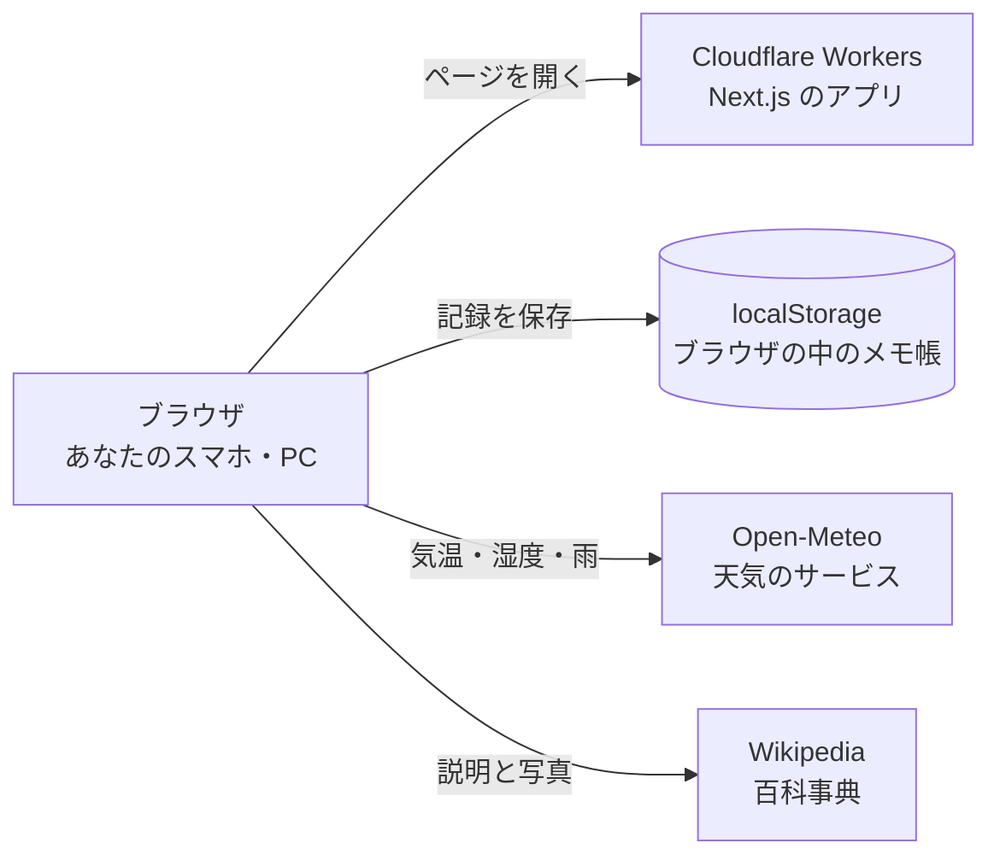

# 使っている道具（技術スタック）

ポートフォリオ（muyoggn/portfolio）と同じ道具を使っています。
それぞれの道具の基本は、ポートフォリオの `docs/STACK.md` にくわしく書いてあるので、
ここでは「このアプリでの使い方」と「新しく使い始めたもの」を中心に説明します。

天気と Wikipedia へは、**ブラウザから直接**取りに行っています。
サーバー（Workers）を通さないので、しくみがシンプルで、Cloudflare の無料枠も使いません。

## ポートフォリオと同じもの

| 道具 | 役割 |
| --- | --- |
| TypeScript | JavaScript に「データの形」のチェックを足した言語。`src/lib/types.ts` で植物データの形を決めています |
| React | 画面を「部品（コンポーネント）」の組み合わせで作るしくみ。`src/components/` が部品置き場 |
| Next.js 16 | React でサイトを作るための土台。`src/app/` のフォルダ構成がそのまま URL になります |
| Tailwind CSS v4 | `class="text-sm text-muted"` のように、クラス名で見た目を書くしくみ |
| Cloudflare Workers + @opennextjs/cloudflare | 作ったアプリを世界中に配信する場所と、そのための変換ツール |

## 新しく使い始めたもの

### localStorage（ローカルストレージ）
ブラウザに最初から入っている、小さな保存場所です。ライブラリの追加はいりません。
- よいところ：サーバーもデータベースもいらず、すぐ使える
- 注意：保存した記録は**そのブラウザの中だけ**。スマホと PC で共有できず、ブラウザのデータを消すと消える
- 保存まわりの処理は `src/lib/storage.ts` にまとめてあるので、あとで Cloudflare D1 に移すときはこのファイルを書きかえます

### Open-Meteo（オープンメテオ）
無料の天気サービスです。**選んだ理由**：登録や API キー（合言葉）がいらず、過去の天気と予報の両方を 1 回で取れるため。
`src/lib/weather.ts` で、過去 60 日と今後 7 日の「平均気温・最高気温・湿度・降水量・天気」を取っています。
地名から緯度・経度を探す「地名検索」も Open-Meteo のものを使っています。

### Wikipedia の API
Wikipedia は記事の要約と写真をデータとして取り出せる窓口（API）を公開しています。
**選んだ理由**：無料・キー不要で、日本語の説明がそろっているため。`src/lib/wiki.ts` を見てください。
※ 育て方（水やり間隔など）は Wikipedia にきちんとした形では載っていないので、
よくある植物の分は `src/data/plants.ts` に自分で表を作っています。

### SVG（部屋の図）
ブラウザに最初から入っている、図形を数字で描くしくみです。部屋の間取り図とドラッグ操作は、ライブラリを使わず SVG と Pointer イベントだけで作っています。
**選んだ理由**：四角と丸と線だけの簡単な図なので、ライブラリを入れるより中身が見えて学びやすいため。

新しいライブラリ（npm でインストールする部品）は、今のところ 1 つも足していません。
